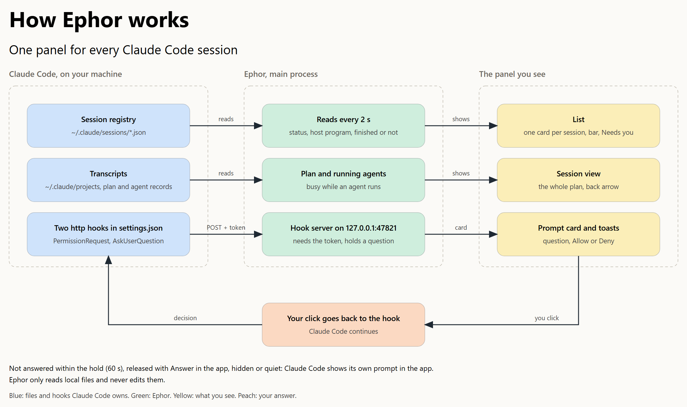

# Ephor


Ephor is a small always-on-top panel for Windows that watches your Claude Code sessions, so you do not have to hunt through windows to see which one needs you.

The name comes from the Greek ephoros, an overseer.

## What it is for

If you run several Claude Code sessions at once, in Claude Desktop, Zed, VS Code, Cursor, JetBrains or a plain terminal, you lose track. One waits for a permission, one has finished, one is still busy with background agents. Ephor puts all of that in one corner of the screen:

- **Status at a glance:** working, needs you, finished, with a progress bar from the session's own plan.
- **Answer from the panel:** option questions and shell command approvals show as cards. One click answers, with two clicks for Allow.
- **Jump to the session:** the arrow brings the right app or window to the front.
- **Stays out of the way:** it hides itself when nothing needs you, stays above full-screen video, and sends a small toast when you cannot see it.

Everything is local. Ephor reads files under `~/.claude`, listens on `127.0.0.1` only, and sends nothing anywhere.

## How it works



1. Claude Code writes a registry entry per session and a transcript per conversation. Ephor reads both every 2 seconds, for the status, the plan and any running agents.
2. For questions and permissions, two `http` hooks in your Claude Code settings send each request to Ephor's local server, together with a token.
3. Ephor holds the request and shows a card. Your click goes back as the hook's answer and Claude Code carries on.
4. If you do not answer in time, release the question, hide the panel or turn on quiet mode, Ephor stays out of it and Claude Code shows its own prompt.

Without the hooks Ephor still works as a viewer. Ephor never edits your Claude Code settings.

## Install and run

```powershell
npm install
npm start
```

To try it with fake sessions and no hooks:

```powershell
$env:EPHOR_DEMO = "1"; npm start
```

To build the Windows installer and portable exe:

```powershell
npm run dist
```

## Turn on answering

Answering needs the token in the user environment variable `EPHOR_HOOK_TOKEN` and two hook entries with `"timeout": 70`. The exact steps are in [docs/superpowers/notes/hook-setup.md](docs/superpowers/notes/hook-setup.md). Use the tray item "Copy token setup command", run the line it gives you, then restart Claude Desktop and your terminals.

## More

- [docs/reference.md](docs/reference.md): every behavior, setting, limit and what is verified or not.
- `docs/superpowers`: the design specs and implementation plans.
- Tests: `npm test`.

## Limits

Windows only. The Claude Desktop link, the transcript format and the registry are undocumented and may change with an update; if they do, Ephor falls back to showing less, and nothing else breaks.
